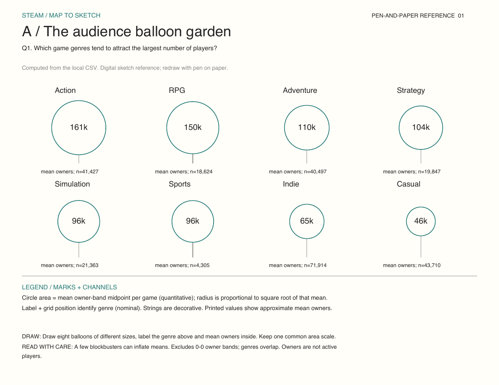
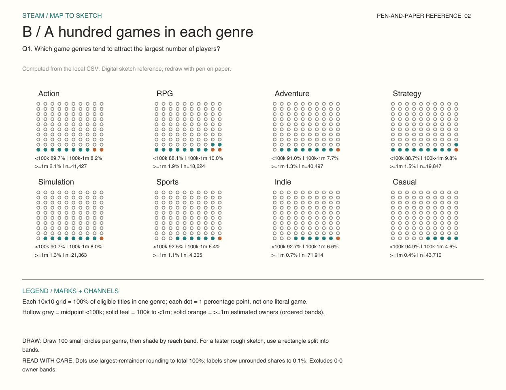
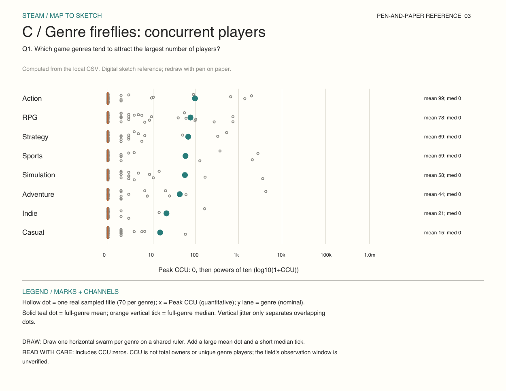

# Q1: Three additional sketch alternatives

**Question:** Which game genres tend to attract the largest number of players?

These are digital references to redraw on paper. All values come from the corrected local CSV (125,855 games); the original sketchbook is unchanged. Eight selected genre labels are compared, not the complete set of genres. Games can belong to multiple genres, so no genre totals should be added as unique players.

## 1. Audience balloon garden

- Circle area = mean owner-band midpoint per game (quantitative); radius is proportional to square root of that mean.
- Label + grid position identify genre (nominal). Strings are decorative. Printed values show approximate mean owners.

**Draw:** Draw eight balloons of different sizes, label the genre above and mean owners inside. Keep one common area scale.

**Limit:** A few blockbusters can inflate means. Excludes 0-0 owner bands; genres overlap. Owners are not active players.

## 2. A hundred games in each genre

- Each 10x10 grid = 100% of eligible titles in one genre; each dot = 1 percentage point, not one literal game.
- Hollow gray = midpoint <100k; solid teal = 100k to <1m; solid orange = >=1m estimated owners (ordered bands).

**Draw:** Draw 100 small circles per genre, then shade by reach band. For a faster rough sketch, use a rectangle split into bands.

**Limit:** Dots use largest-remainder rounding to total 100%; labels show unrounded shares to 0.1%. Excludes 0-0 owner bands.

## 3. Genre fireflies

- Hollow dot = one real sampled title (70 per genre); x = Peak CCU (quantitative); y lane = genre (nominal).
- Solid teal dot = full-genre mean; orange vertical tick = full-genre median. Vertical jitter only separates overlapping dots.

**Draw:** Draw one horizontal swarm per genre on a shared ruler. Add a large mean dot and a short median tick.

**Limit:** Includes CCU zeros. CCU is not total owners or unique genre players; the field's observation window is unverified.

## Which is most useful?

The hundred-game grids best answer which genres *tend* to reach a large audience because they expose the proportion of titles in each reach band. The balloons give an immediate comparison but are sensitive to blockbuster outliers. The fireflies provide a different definition of players: concurrent users rather than estimated owners. None of these measures is revenue or profitability.
