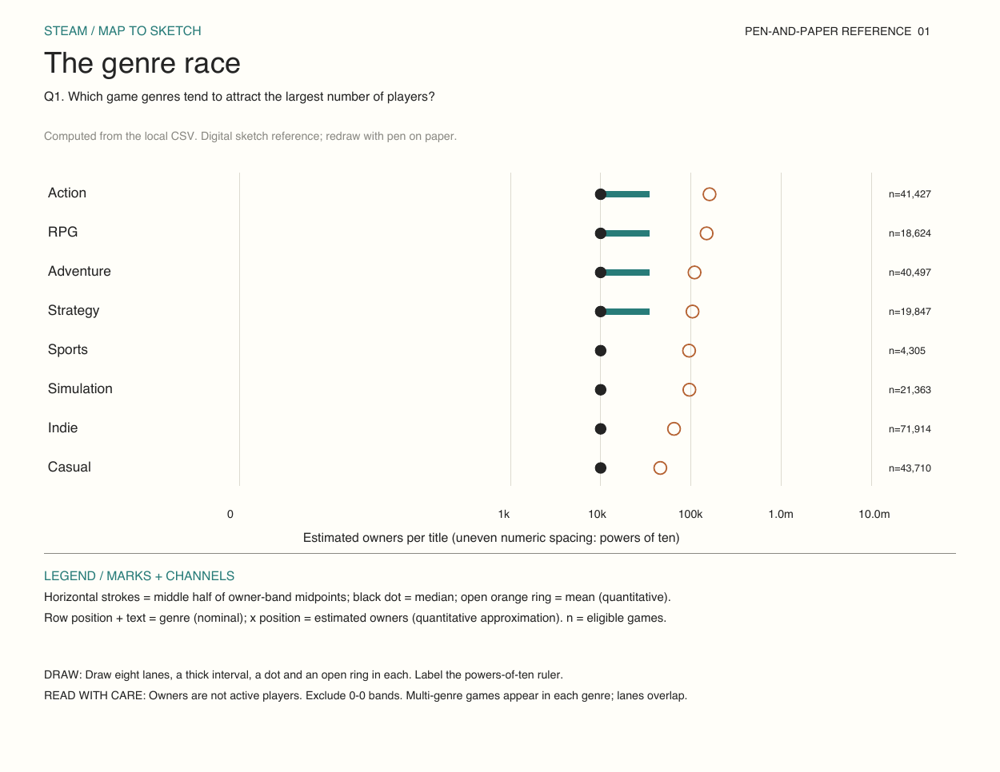
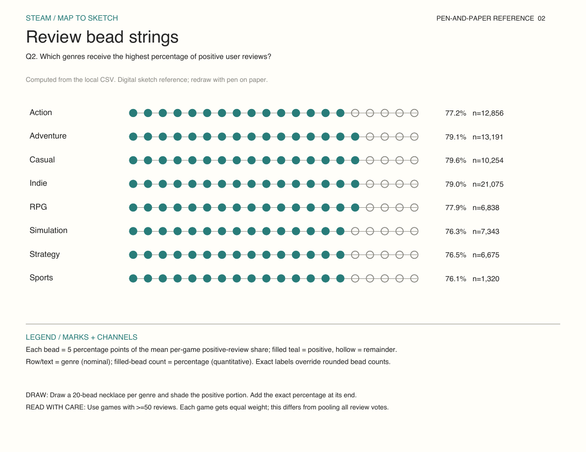
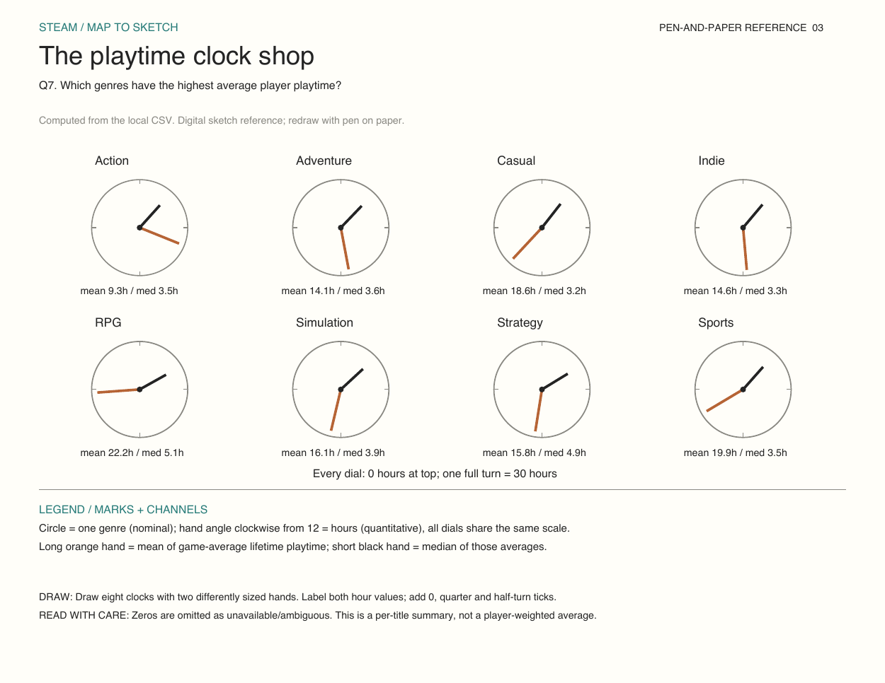
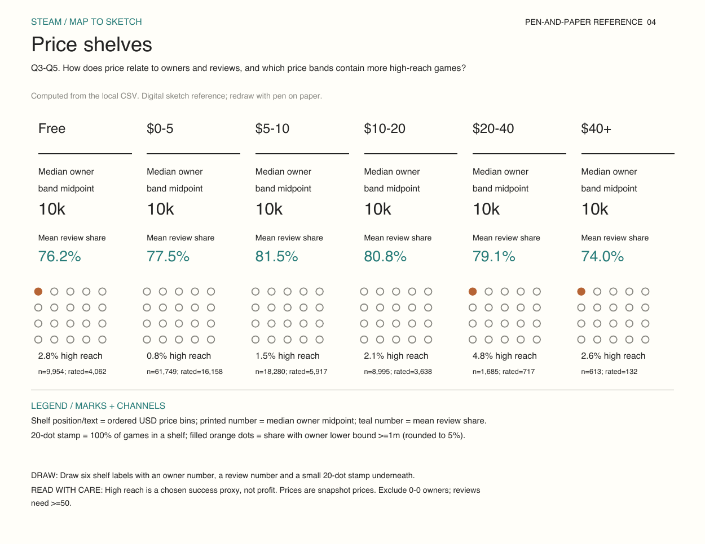
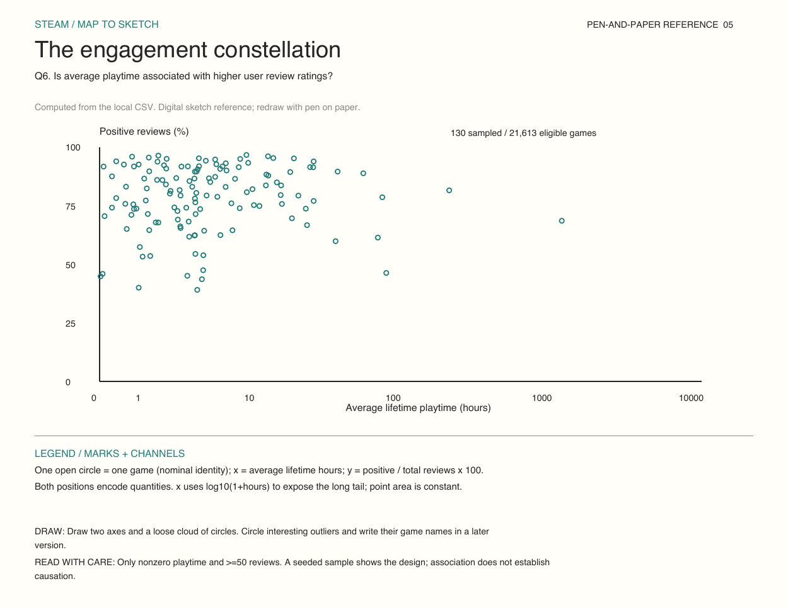
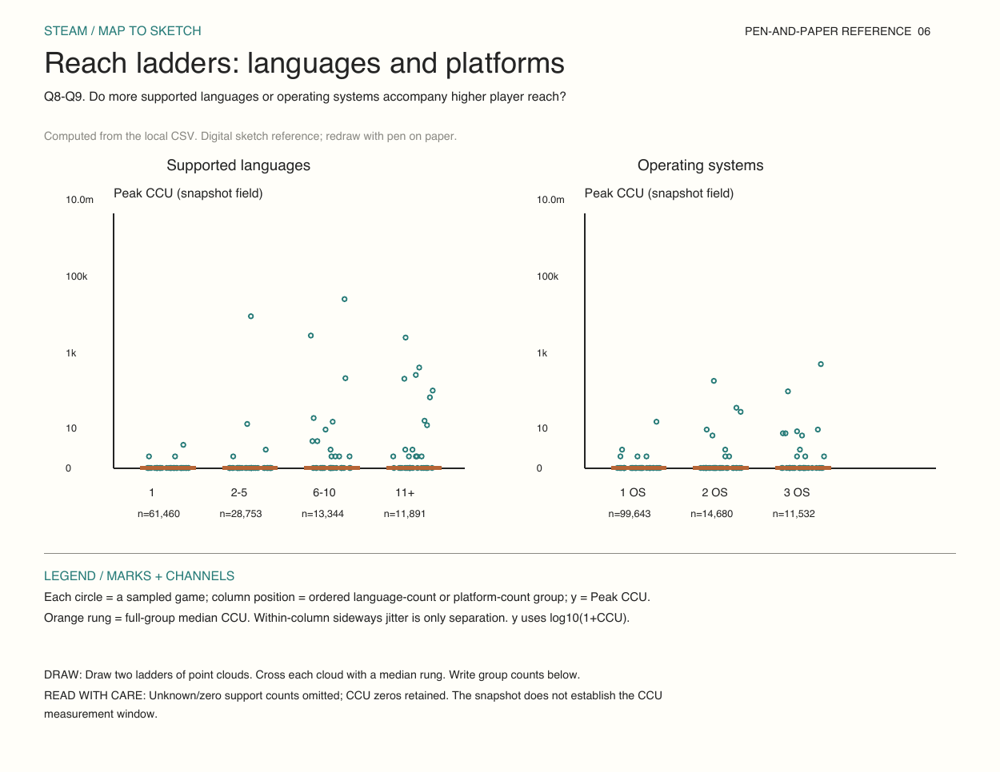
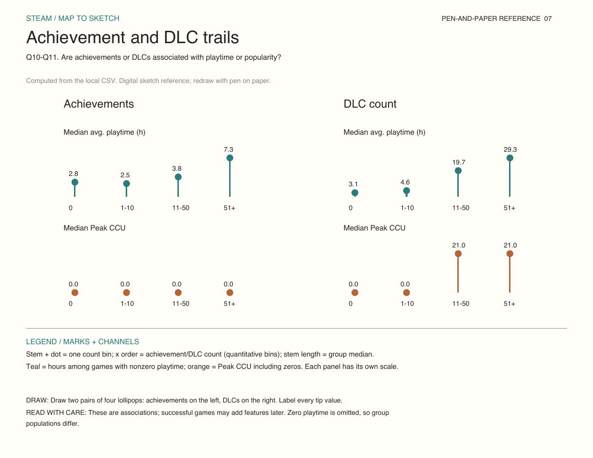
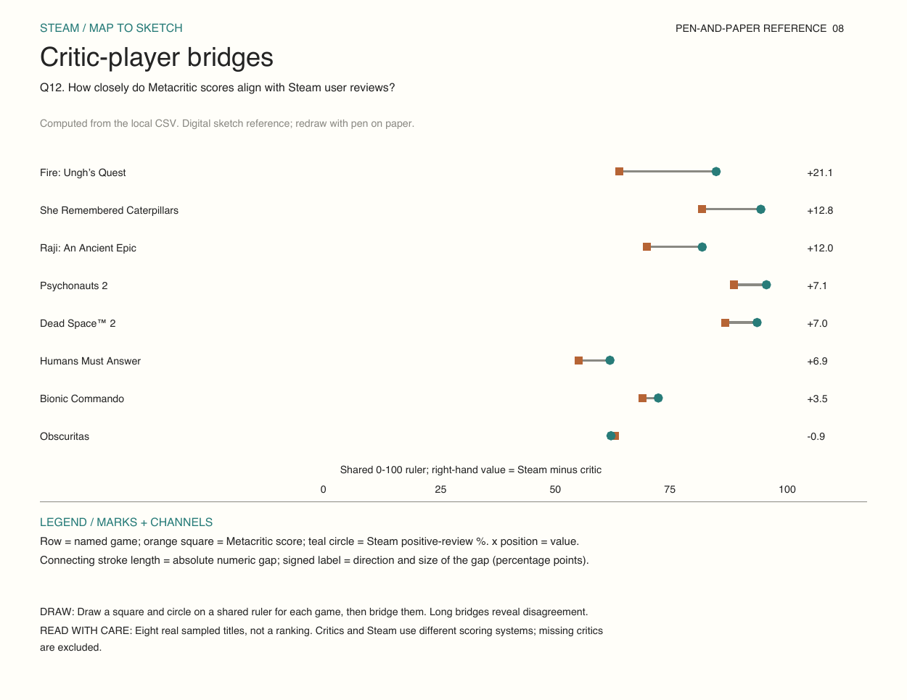
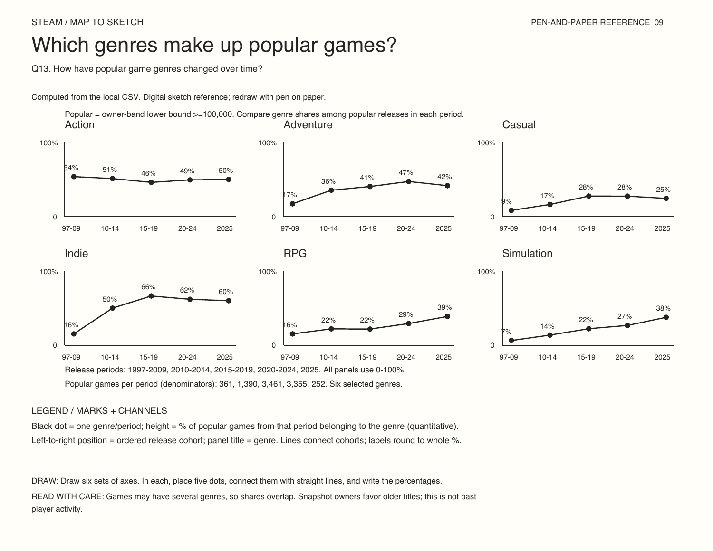
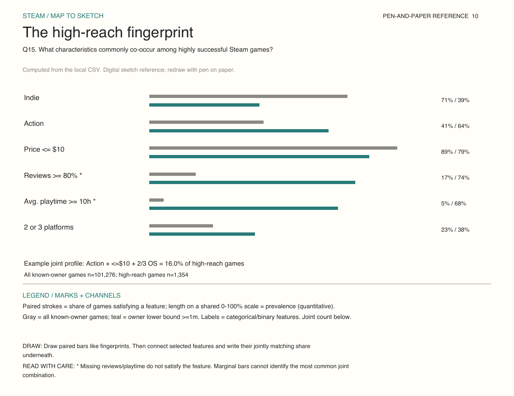

# Map to Sketch: Steam games

These are digital reference sketches for a pen-and-paper assignment. Redraw at least five with a Sharpie, include each legend, and photograph the physical sketches for submission. Ten references cover Q1-Q12 and Q15, plus an explicit cohort proxy for Q13. The simplified ninth sketch focuses on owner reach; Q14 is no longer shown. Each explores a separate question or closely related question family rather than one dashboard answering everything.

## Grounding and processing

Source: `MS2.docx` and `dataset/games.csv` in this project. The CSV header has 39 names for 40 values; split `DiscountDLC count` into `Discount` and `DLC count` before reading later fields. Every row is checked for the corrected width. The CSV, not the JSON twin, is the canonical source for these sketches because they have different row counts.

Parsed 125,855 CSV rows. Owner ranges are estimates; 0-0 bands are excluded from owner comparisons. No owner measure is sales, revenue or unique active players. Steam sentiment = Positive/(Positive+Negative), restricted to >=50 reviews. Lifetime average playtime is converted from minutes to hours; zero reports are excluded as ambiguous/missing. Peak CCU is used under its field name because its time window is not independently documented here. Language count is the count of distinct parsed list entries; platform count is the sum of Windows/Mac/Linux flags.

Selected genres are examples, not an exhaustive ranking. Multi-genre membership is retained, so genre counts overlap. Group means use equal title weights; pooled review-vote percentages answer a different question. Real sampled dots are seeded for reproducibility and should not be used to claim whole-dataset trends. Price bands are (0,5], (5,10], (10,20], (20,40], >40 and free separately. High reach means owner-band lower bound >=1,000,000; it is an adjustable, nonfinancial definition of success.

No chart establishes that adding languages, platforms, achievements or DLC causes success. The dataset does not identify studio headcount, development costs or historical ownership/player trajectories. Q13 needs repeated dated snapshots for an actual historical-popularity answer. The fingerprint gives marginal prevalence and one real joint example; a later explorer must count candidate combinations directly to rank joint profiles, ideally within genre and release cohorts.

## 1. The genre race

**Question:** Q1: genre and audience reach.

**Visual encoding legend**

- Horizontal strokes = middle half of owner-band midpoints; black dot = median; open orange ring = mean (quantitative).
- Row position + text = genre (nominal); x position = estimated owners (quantitative approximation). n = eligible games.

**Paper drawing:** Draw eight lanes, a thick interval, a dot and an open ring in each. Label the powers-of-ten ruler.

**Interpretation:** Owners are not active players. Exclude 0-0 bands. Multi-genre games appear in each genre; lanes overlap.

## 2. Review bead strings

**Question:** Q2: genre and positive-review percentage.

**Visual encoding legend**

- Each bead = 5 percentage points of the mean per-game positive-review share; filled teal = positive, hollow = remainder.
- Row/text = genre (nominal); filled-bead count = percentage (quantitative). Exact labels override rounded bead counts.

**Paper drawing:** Draw a 20-bead necklace per genre and shade the positive portion. Add the exact percentage at its end.

**Interpretation:** Use games with >=50 reviews. Each game gets equal weight; this differs from pooling all review votes.

## 3. The playtime clock shop

**Question:** Q7: genre and average playtime.

**Visual encoding legend**

- Circle = one genre (nominal); hand angle clockwise from 12 = hours (quantitative), all dials share the same scale.
- Long orange hand = mean of game-average lifetime playtime; short black hand = median of those averages.

**Paper drawing:** Draw eight clocks with two differently sized hands. Label both hour values; add 0, quarter and half-turn ticks.

**Interpretation:** Zeros are omitted as unavailable/ambiguous. This is a per-title summary, not a player-weighted average.

## 4. Price shelves

**Question:** Q3, Q4, Q5: price, owners, reviews and success.

**Visual encoding legend**

- Shelf position/text = ordered USD price bins; printed number = median owner midpoint; teal number = mean review share.
- 20-dot stamp = 100% of games in a shelf; filled orange dots = share with owner lower bound >=1m (rounded to 5%).

**Paper drawing:** Draw six shelf labels with an owner number, a review number and a small 20-dot stamp underneath.

**Interpretation:** High reach is a chosen success proxy, not profit. Prices are snapshot prices. Exclude 0-0 owners; reviews need >=50.

## 5. The engagement constellation

**Question:** Q6: playtime and reviews.

**Visual encoding legend**

- One open circle = one game (nominal identity); x = average lifetime hours; y = positive / total reviews x 100.
- Both positions encode quantities. x uses log10(1+hours) to expose the long tail; point area is constant.

**Paper drawing:** Draw two axes and a loose cloud of circles. Circle interesting outliers and write their game names in a later version.

**Interpretation:** Only nonzero playtime and >=50 reviews. A seeded sample shows the design; association does not establish causation.

## 6. Reach ladders

**Question:** Q8, Q9: localization, platforms and reach.

**Visual encoding legend**

- Each circle = a sampled game; column position = ordered language-count or platform-count group; y = Peak CCU.
- Orange rung = full-group median CCU. Within-column sideways jitter is only separation. y uses log10(1+CCU).

**Paper drawing:** Draw two ladders of point clouds. Cross each cloud with a median rung. Write group counts below.

**Interpretation:** Unknown/zero support counts omitted; CCU zeros retained. The snapshot does not establish the CCU measurement window.

## 7. Achievement and DLC trails

**Question:** Q10, Q11: features and engagement.

**Visual encoding legend**

- Stem + dot = one count bin; x order = achievement/DLC count (quantitative bins); stem length = group median.
- Teal = hours among games with nonzero playtime; orange = Peak CCU including zeros. Each panel has its own scale.

**Paper drawing:** Draw two pairs of four lollipops: achievements on the left, DLCs on the right. Label every tip value.

**Interpretation:** These are associations; successful games may add features later. Zero playtime is omitted, so group populations differ.

## 8. Critic-player bridges

**Question:** Q12: Metacritic vs Steam.

**Visual encoding legend**

- Row = named game; orange square = Metacritic score; teal circle = Steam positive-review %. x position = value.
- Connecting stroke length = absolute numeric gap; signed label = direction and size of the gap (percentage points).

**Paper drawing:** Draw a square and circle on a shared ruler for each game, then bridge them. Long bridges reveal disagreement.

**Interpretation:** Eight real sampled titles, not a ranking. Critics and Steam use different scoring systems; missing critics are excluded.

## 9. Which genres make up popular games?

**Question:** Q13: How have popular game genres changed over time? (release-cohort proxy).

**Visual encoding legend**

- Black dot = one genre/period; height = % of popular games from that period belonging to the genre (quantitative).
- Left-to-right position = ordered release cohort; panel title = genre. Lines connect cohorts; labels round to whole %. 

**Paper drawing:** Draw six sets of axes. In each, place five dots, connect them with straight lines, and write the percentages.

**Interpretation:** Games may have several genres, so shares overlap. Snapshot owners favor older titles; this is not past player activity.

## 10. The high-reach fingerprint

**Question:** Q15: common characteristics and combinations.

**Visual encoding legend**

- Paired strokes = share of games satisfying a feature; length on a shared 0-100% scale = prevalence (quantitative).
- Gray = all known-owner games; teal = owner lower bound >=1m. Labels = categorical/binary features. Joint count below.

**Paper drawing:** Draw paired bars like fingerprints. Then connect selected features and write their jointly matching share underneath.

**Interpretation:** * Missing reviews/playtime do not satisfy the feature. Marginal bars cannot identify the most common joint combination.

## Implementation direction

All sketches can be implemented with basic text, points, strokes, circles and rectangles. Group and aggregate before rendering; use AppID for title-level drill-down. Later interactions could reveal game names and owner bands, change the success threshold, compare genre and release cohorts, or expand platform counts to actual OS combinations. For the clock shop, add quarter-turn ticks when redrawing; the shared scale and printed hour labels prevent confusing clock time with duration.

Keep the hand sketches rough: aim for 3-5 minutes per concept. Retain alternative forms rather than choosing a final design now.
