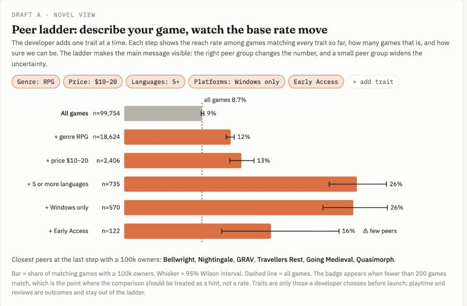
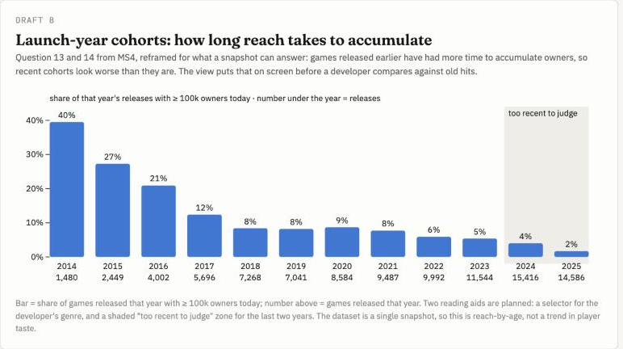
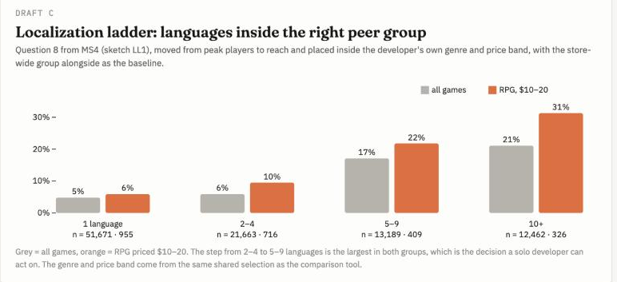

# Prototype V1 · story arc, novel view and visualization drafts

Paste into the process book under the Prototype V1 heading. Images are in `process-book/img/`.

## How the site follows the data storytelling arc

The lecture on storyboards gives the arc we built the page around (Brent Dykes's data storytelling arc on Freytag's shape): setting with a hook, rising insights, the aha moment, then solution and next steps. Our MS6 storyboard already had six frames; for V1 we checked each frame against the lecture's four questions.

| Arc stage | Frame on the site | What it answers | Why the frame cannot be left out |
|---|---|---|---|
| 1 Setting and hook | *Does a low price mean greater reach?* 85% of games with 100k+ owners cost $10 or less. | Names the audience (solo developers), the problem (survivorship bias) and the first number that fed it. | Without it the reader has no reason to suspect their instinct. |
| 2 Rising insight | *Counts can give the wrong impression.* Share of successful games per shelf against reach rate inside the shelf: 7% at $0–5, 18% at $20–40. | The reader's first question: "so I should price low?" | This is the pivot from count to rate; every later frame depends on it. |
| 3 Rising insight | *Genre changes the comparison.* All genres 18% against RPG 22% at $20–40, with a genre selector. | "Is the store-wide rate even my rate?" | Shows the baseline itself has to be chosen; sets up the peer idea. |
| 4 Rising insight | *Comparable games have different traits.* 82% against 47% on playtime, 25% against 35% on platforms. | "What do the games I would be compared with look like?" | Turns the message from pricing alone into budgeting decisions. |
| 5 Aha moment | *Compare rates among relevant peers.* One sentence in a callout, plus what the data cannot say. | The major point. | The arc's peak; the tool below is meaningless without it. |
| 6 Solution and next steps | Four steps a developer can take, then the comparison tool, the explorer, and the drafts of V2 views. | "What do I do now?" | Empowers the audience to act, which the lecture names as the last storyboarding step. |

Changes made after the lecture: a short *setting* paragraph before the hook statistic, an italic *curiosity question* opening frames 2 to 4 so the sequence mirrors the reader's path, the arc stage named in each frame's label, and a four-step call to action at the top of the solution frame.

## Novel view: the peer ladder (Draft A)

**What it is.** The developer describes their own game one trait at a time: genre, price band, languages, platforms, Early Access. Each added trait becomes a rung. The rung shows the reach rate (share with 100k+ owners) among all games matching every trait so far, the number of such games, and a 95% Wilson interval. A dashed line marks the store-wide rate. When fewer than 200 games match, a "few peers" badge appears and the whisker visibly widens. Below the ladder, the closest successful peers are named.

**Why it is novel for this story.** The comparison tool (MS5 Prototype A) shows one peer group at a time. The ladder shows the *path* to a peer group and makes two things visible at once that our main message depends on: the base rate moving as the comparison narrows, and the cost of narrowing (uncertainty growing as n shrinks). It is a base-rate argument turned into an interaction. Only traits a developer chooses before launch are allowed on the ladder; playtime and reviews are outcomes and stay out.

**Real numbers from the pipeline** (owner band ≥ 100k): all games 8.7% (n = 99,754) → RPG 11.9% (18,624) → $10–20 13.1% (2,406) → 5+ languages 26.0% (735) → Windows only 25.6% (570) → Early Access 16.4% (122, interval 10.9% to 24.0%).

**Interaction plan.** Chips add or remove traits; dragging a chip reorders rungs so the user can see that the order of narrowing changes the intermediate rates but not the final one. Hover on a rung lists its peers. The threshold control is shared with the rest of the site. Rungs animate in from the previous rung's bar so the move is read as a change, not a new chart.

**Open design questions.** Whether to allow more than five traits (the n collapses fast); whether to show the interval as a whisker or a lighter band; how to word the warning so it reads as caution rather than a verdict.

## Draft B: launch-year cohorts

Questions 13 and 14 from MS4 asked about change over time. A single snapshot cannot answer them directly, but it can show the thing that misleads developers most when they compare against old hits: owners accumulate. Share of a year's releases with 100k+ owners today falls from 40% (2014, n = 1,480) to 5% (2023, n = 11,544). Planned aids: a genre selector, and a shaded "too recent to judge" zone over the last two years. Encoding: bar height = cohort reach rate, label under the year = releases in that year.

## Draft C: localization ladder

Question 8 from MS4 (sketch LL1) asked whether more languages go with more players. V1 reframes it on reach and inside the right peer group. Across all games the rate rises from 5% (1 language) to 21% (10+); inside RPG $10–20 it rises from 6% to 31%, and the largest step in both groups is from 2–4 to 5–9 languages. Grouped bars, grey for all games and orange for the selected genre and price band, which come from the shared selection. The caveat from MS6 stays attached: better-funded teams localize more, and successful games add translations after launch.
